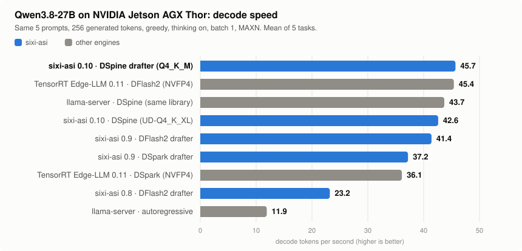
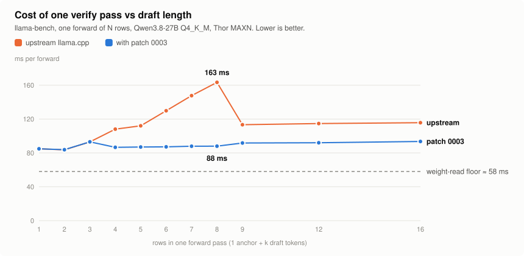
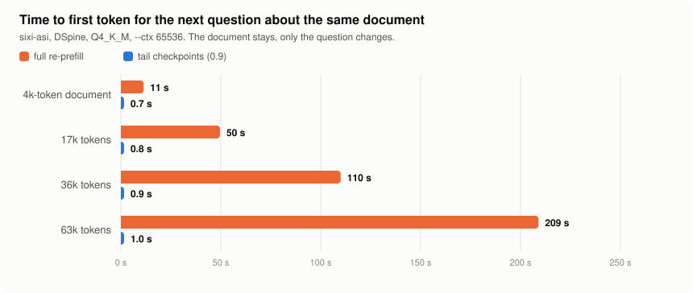

# sixi-asi

Speculative-decoding inference server for hybrid Gated-DeltaNet + attention LLMs (Qwen3.8 family) on NVIDIA
unified-memory hardware. C++20, OpenAI-compatible HTTP API, llama.cpp as the compute backend, zero Python on the
inference path. Public fork of a private research branch. **Version 0.9.**

| | 0.8 | **0.9** |
|---|---|---|
| Qwen3.8-27B decode, mean of 5 tasks | 23.2 tok/s | **45.3 tok/s** (3.8x plain autoregressive) |
| Reasoning workload (GSM8K + HumanEval, thinking on) | - | **65.7 tok/s**, 28/30 and 19/20 |
| Next question about a 63k-token document | 209 s | **1.0 s** to first token |
| Verify pass of 8 rows | 163 ms | **88 ms** |

<picture>
  <source media="(prefers-color-scheme: dark)" srcset="assets/engines-dark.svg">
  
</picture>

## What changed in 0.9

| Area | Change | Effect |
|---|---|---|
| Kernels | llama.cpp patch 0003 for Thor (sm_110): k-quants switch from the vector kernel to the matrix kernel at 4 rows, and the matrix kernel runs 128 threads x 4 blocks per SM for skinny batches | 8-row verify 163 -> 88 ms, 16-row 116 -> 94 ms |
| Drafters | DSpine (16-token block), DSpark (Markov + confidence head) and DFlash2 behind one interface; the context n-gram drafter no longer overrides a block drafter | 23.2 -> 45.3 tok/s |
| Draft length | Acceptance-driven for DSpine (15 or 4), full block for 7-token drafters | +2 to 4% over a fixed length |
| Long context | Two checkpoints near the end of every long prefill (device-side, ~1 ms each) | follow-up question TTFT 11-209 s -> 0.7-1.0 s |
| Quality gate | Token budget raised to 8192 so reasoning is never cut short | same misses for every engine and quantization |

<picture>
  <source media="(prefers-color-scheme: dark)" srcset="assets/verify-cost-dark.svg">
  
</picture>

Profiling one forward pass showed quantized matrix products are 83-92% of GPU time and the Gated DeltaNet recurrence
about 3 ms. The per-row verify cost was the vector kernel decoding the weights again for every row, and the matrix
kernel was latency-bound with one block per SM. Both are launch-shape changes: same weights, same results
(`test-backend-ops` MUL_MAT and MUL_MAT_ID pass).

## Measured

NVIDIA Jetson AGX Thor developer kit (122.9 GiB unified LPDDR5X, ~273 GB/s, CUDA 13.2, MAXN). Qwen3.8-27B, greedy,
batch 1, identical prompts for every engine, 256 generated tokens, median of 3 runs per task. llama.cpp a691b234
plus `patches/llama.cpp` for sixi-asi and llama-server. Every number below was re-measured on the published build;
raw JSON is in `configs/benchmarks/2026-11-10/`.

| Engine | Weights | Drafter | tok/s | vs AR |
|---|---|---|---|---|
| TensorRT Edge-LLM 0.11.1 | NVFP4 | DFlash2 | 45.4 | 3.8x |
| **sixi-asi 0.9** | Q4_K_M | DSpine b16 | **45.3** | **3.8x** |
| llama-server | Q4_K_M | DSpine b16 | 43.7 | 3.7x |
| sixi-asi 0.9 | Q4_K_M | DFlash2 | 41.4 | 3.5x |
| **sixi-asi 0.9** | UD-Q4_K_XL | DSpine b16 | **38.6** | 3.2x |
| sixi-asi 0.9 | Q4_K_M | DSpark | 37.2 | 3.1x |
| TensorRT Edge-LLM 0.11.1 | NVFP4 | DSpark | 36.1 | 3.0x |
| llama-server | UD-Q4_K_XL | DSpine b16 | 35.7 | 3.0x |
| llama-server, autoregressive | Q4_K_M | - | 11.9 | 1.0x |

Edge-LLM is NVIDIA's TensorRT runtime with native NVFP4 weights; it was run with thinking enabled like the others
(its server defaults to thinking off, which produces shorter, faster answers and is not comparable).

**Quality gate** (`scripts/intel_eval.py`, reasoning effort low, thinking on, greedy, up to 8192 tokens):

| Engine | GSM8K | HumanEval | Tool calls | Needle (6k) | tok/s |
|---|---|---|---|---|---|
| **sixi-asi, DSpine, Q4_K_M** | 28/30 | 19/20 | pass | pass | **65.7** |
| TensorRT Edge-LLM, DFlash2, NVFP4 | 28/30 | 19/20 | pass | pass | 61.5 |
| sixi-asi, DSpine, UD-Q4_K_XL | 28/30 | 19/20 | pass | pass | 54.5 |

All three miss the same three items, so the misses belong to the model, not to an engine or a quantization.
KL divergence against BF16 logits: UD-Q4_K_XL 0.009, Q4_K_M 0.025.

**Long context** (`scripts/longctx_bench.py`, `--ctx 65536`, DSpine, Q4_K_M):

<picture>
  <source media="(prefers-color-scheme: dark)" srcset="assets/long-context-dark.svg">
  
</picture>

| Document | First question | Next question | Decode |
|---|---|---|---|
| 4k tokens | 12 s | 0.65 s | 30-48 tok/s |
| 17k | 51 s | 0.75 s | 28-39 tok/s |
| 36k | 111 s | 0.86 s | 24-34 tok/s |
| 63k | 211 s | 1.00 s | 19-29 tok/s |

Prefill runs at 300-340 tok/s. The KV cache costs about 70 KB per token (17 attention layers; the recurrent layers
keep a fixed-size state), so 64k tokens of context is about 4.5 GB: on this box context length is a time budget,
not a memory budget.

## What it does

- **Lossless speculative decoding with O(1) state rollback.** A drafter proposes up to 15 tokens, the target
  verifies them in one batched pass, and the recurrent state rolls back through llama.cpp's snapshot ring. Greedy
  and sampled decoding both match plain autoregressive sampling (distribution-tested).
- **Prefix cache.** Live-state continuation, ring rollback, device-side snapshot slots and tail checkpoints; optional
  NVMe persistence. A repeated prompt needs no forward pass (TTFT 1 ms).
- **Native Qwen3.8 chat template** (tools, reasoning effort, thinking on/off), byte-identical to llama.cpp's Jinja
  rendering; reasoning budgets that force `</think>` instead of an empty answer; schema-validated tool calls.
- **Honest benchmarking.** Identical prompts for every engine, outputs diffed against the autoregressive reference,
  quality gated by GSM8K, HumanEval, a tool-call protocol test and a needle test.

## Build

```bash
# llama.cpp backend: pinned commit + patches/llama.cpp (sm_110, CUDA graphs, flash attention)
scripts/build_llamacpp.sh a691b2345844

cmake -B build -DCMAKE_BUILD_TYPE=Release && cmake --build build -j$(nproc)
ctest --test-dir build --output-on-failure
```

Requirements: CUDA 12+/13, CMake 3.24, GCC 13, OpenSSL. Patch 0003 only changes behaviour on compute capability
11.0 (Thor); other GPUs keep upstream's tables.

## Run

```bash
./build/sixi-server --model Qwen3.8-27B-Q4_K_M.gguf \
    --draft-model Qwen3.8-27B-DSpine-b16-Q4_K_M.gguf \
    --ctx 32768 --port 8089

curl -s localhost:8089/v1/chat/completions -d '{
  "messages": [{"role": "user", "content": "What is 17*23?"}],
  "max_tokens": 1024, "temperature": 0 }'
```

`--ctx 32768` suits everyday work with documents (about 50 pages); up to 65536 was measured above. Useful flags:
`--spec-k N`, `--spec-k-max N`, `--spec-k-fixed`, `--no-spec`, `--device-slots N`, `--kv-type q8_0`,
`--snapshot-dir PATH`, `--api-key KEY`, `--max-concurrent N`. Endpoints: `/v1/chat/completions`, `/health`,
`/metrics`, `/apply-template`.

## Reproduce the numbers

```bash
python3 scripts/ab_bench.py --engines sixi=http://127.0.0.1:8089,llama-ar=http://127.0.0.1:8099 \
    --reference llama-ar --max-tokens 256 --repeats 3 --out ab.json
python3 scripts/intel_eval.py --engines sixi=http://127.0.0.1:8089 --effort low --max-tokens 8192
python3 scripts/longctx_bench.py --url http://127.0.0.1:8089 --corpus 'docs/**/*.md' --sizes 56000,32000,16000,4000
python3 scripts/template_parity.py --sixi http://127.0.0.1:8089 --llama http://127.0.0.1:8099
python3 scripts/make_readme_charts.py          # charts above, from assets/chart-data.json
```

## Layout

`src/server` HTTP server, chat template, tool-call validation, prefix cache. `src/speculative` drafters and the
lossless verifier. `src/core` llama.cpp backend (state snapshots, DSpine / DSpark / DFlash2 protocols),
deterministic sampler. `src/io` GGUF parser and manifests. `src/memory` memory planner. `patches/llama.cpp` kernel
and drafter patches for the pinned backend. `tests/` unit and integration tests.

## License

Apache-2.0.
