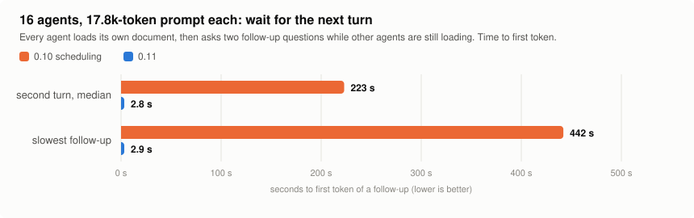
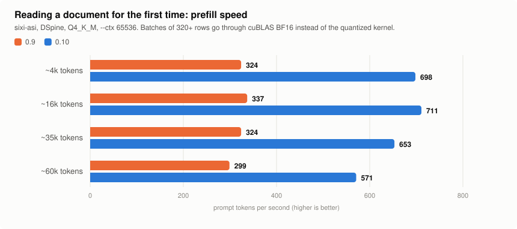

# sixi-asi

Speculative-decoding inference server for hybrid Gated-DeltaNet + attention LLMs (Qwen3.8 family) on NVIDIA
unified-memory hardware. C++20, OpenAI-compatible HTTP API, llama.cpp as the compute backend, zero Python on the
inference path. Public fork of a private research branch. **Version 0.11.**

| | 0.10 | **0.11** |
|---|---|---|
| 32 requests at once, aggregate | 129 tok/s | **169-171 tok/s** (`--parallel 32`) |
| 16 requests at once | 129 tok/s | **151-154 tok/s** |
| 4 requests at once | 94.2 tok/s | **103.5 tok/s** |
| 16 agents with a 17.8k-token prompt each: wait for the next turn | up to 442 s | **under 3 s** |
| Context memory for 32 streams | 70.2 GB | **27.1 GB** |
| Default weights | Q4_K_M (KL divergence 0.025 to BF16) | **UD-Q4_K_XL v3.1 (0.008)** at 44.0 tok/s |
| One stream, Q4_K_M, mean of 5 tasks | 45.7 tok/s | 45.5 tok/s (3.8x plain autoregressive) |

<picture>
  <source media="(prefers-color-scheme: dark)" srcset="assets/streams-dark.svg">
  
</picture>

## What changed in 0.11

| Area | Change | Effect |
|---|---|---|
| Recurrent state rollback | llama.cpp patch 0007: one state per sequence plus a log of the last rows' inputs, replayed on rollback, instead of one 144 MiB snapshot per verified row | context memory for 32 streams 70.2 -> 27.1 GB; whole-batch and repeated rollbacks are legal |
| Recurrent state reads | Patch 0006: the delta-net kernel reads the states in place and concatenates without a copy | 32 streams 129 -> 169 tok/s together with 0007 |
| Shared passes | The rendezvous window follows the last pass time, and a stream that misses a pass no longer splits it into several weight reads | 16 streams 129 -> 154 tok/s |
| Long prompts under load | Prefills of 1024+ tokens run outside the request lock and hand the device to waiting requests between chunks | 16 agents: a follow-up waits under 3 s instead of up to 442 s |
| Memory admission | Patch 0005 sizes a context without allocating it; the server refuses a configuration that does not fit and says what would | no more out-of-memory hangs on unified memory |
| Default weights | Unsloth Dynamic v3.1 UD-Q4_K_XL | KL divergence to BF16 0.008 instead of 0.025 for 2-7% of the speed |
| Voting | `"vote": true` with `n` samples: the server returns the majority answer and stops the remaining samples once it is decided | three samples of a hard question in less time than three full answers |

<picture>
  <source media="(prefers-color-scheme: dark)" srcset="assets/agents-dark.svg">
  
</picture>

## What changed in 0.10

| Area | Change | Effect |
|---|---|---|
| Parallel streams | `--parallel N`: each request leases a backend sequence; the draft and verify passes of all generating streams run as one forward pass each | 4 streams 94.2 tok/s aggregate, 24-26 tok/s each |
| Draft length | Follows the number of generating streams (15 or 4 alone, 7 for 2-3 streams, 5 for 4) | 4 streams: 94 instead of 70 tok/s at a fixed 15 |
| Prefill kernels | llama.cpp patch 0004 for Thor: batches of 320+ rows are dequantized and multiplied by cuBLAS in BF16 instead of the quantized kernel | 2048 rows in 2.2 s instead of 4.9 s |
| Prefill scheduling | Largest chunk when alone; time-sliced with generation when other streams are decoding | a document load no longer stalls other chats |
| UD quant mixes | Patch 0003 now covers Q5_K, IQ4_XS, IQ4_NL and Q8_0 | UD-Q4_K_XL 16-row verify 115 -> 100 ms |
| Drafter contexts | The unused chained-MTP context is released when a block drafter is loaded | short-prompt TTFT 327 -> ~210 ms |

<picture>
  <source media="(prefers-color-scheme: dark)" srcset="assets/prefill-dark.svg">
  
</picture>

## Measured

NVIDIA Jetson AGX Thor developer kit (122.9 GiB unified LPDDR5X, ~273 GB/s, CUDA 13.2, MAXN). Qwen3.8-27B, greedy,
identical prompts for every engine, 256 generated tokens. llama.cpp a691b234 plus `patches/llama.cpp` for sixi-asi
and llama-server. The 0.11 rows were measured on the published build with the library built from the clean pinned
commit and the eight patches (raw JSON in `configs/benchmarks/2026-11-12/`); rows marked 0.9 and 0.10 and the other
engines are from those releases' runs. The 0.10 figures beyond 4 streams and the 0.10 agent waits were measured on
the 0.10 code before this work started.

<picture>
  <source media="(prefers-color-scheme: dark)" srcset="assets/engines-dark.svg">
  
</picture>

**One stream** (`scripts/ab_bench.py`, median of 3 runs per task, mean of 5 tasks):

| Engine | Weights | Drafter | tok/s | vs AR |
|---|---|---|---|---|
| **sixi-asi 0.11** | Q4_K_M | DSpine b16 | **45.5** | **3.8x** |
| TensorRT Edge-LLM 0.11.1 | NVFP4 | DFlash2 | 45.4 | 3.8x |
| llama-server | Q4_K_M | DSpine b16 | 43.7 | 3.7x |
| **sixi-asi 0.11** | UD-Q4_K_XL v3.1 (default) | DSpine b16 | **44.0** | 3.7x |
| sixi-asi 0.9 | Q4_K_M | DFlash2 | 41.4 | 3.5x |
| sixi-asi 0.9 | Q4_K_M | DSpark | 37.2 | 3.1x |
| TensorRT Edge-LLM 0.11.1 | NVFP4 | DSpark | 36.1 | 3.0x |
| llama-server, autoregressive | Q4_K_M | - | 11.9 | 1.0x |

**Concurrent requests** (`scripts/concurrency_bench.py`: every client thread answers the same five prompts, rotated,
so the streams carry equal work; aggregate = all completion tokens / wall time, prefill included). 1-4 streams on
`--parallel 4`, 8-32 on `--parallel 32`:

| Concurrent streams | 1 | 2 | 4 | 8 | 16 | 32 |
|---|---|---|---|---|---|---|
| 0.11, UD-Q4_K_XL v3.1 (default) | 37.7 | 63.7 | 90.3 | 118.7 | 150.6 | **170.5** |
| 0.11, Q4_K_M | 40.1 | 65.4 | 99.8 | 123.4 | 154.4 | **168.9** |
| 0.11, Q4_K_M, 1-4 streams on `--parallel 32` | 38.3 | 65.1 | **103.5** | | | |
| 0.10, Q4_K_M | 39.6 | 62.1 | 94.2 | 113.5 | 128.8 | 129.4 |
| llama-server `-np 4`, draft 7 (0.10 run) | 37.4 | 61.0 | 83.8 | | | |

With 32 streams each one decodes at 5.4-5.9 tok/s; with 16, about 10. Context memory for 36 sequences (32 streams and
4 snapshot slots): 27.1 GB (25.3 GiB) for the target, 6.0 GB (5.6 GiB) for the drafter.

**Many agents with long prompts** (`scripts/agents_bench.py`: 16 agents, each with its own 17.8k-token document and
two follow-up questions, `--parallel 16 --ctx 24576`, default weights): a follow-up reaches its first token after
2.8 s (median), 2.9 s at worst, while other agents are still loading their documents; the first answer takes 271 s
(median) because sixteen cold 17.8k-token loads share one device. All three turns of all agents: 530 s.

Plain autoregressive decoding batches as well: 11.8 tok/s for one stream, 41.0 aggregate for four.

**Quality gate** (`scripts/intel_eval.py`, reasoning effort low, thinking on, greedy, up to 8192 tokens):

| Run | GSM8K | HumanEval | Tool calls | Needle (6k) | tok/s |
|---|---|---|---|---|---|
| sixi-asi 0.11, DSpine, UD-Q4_K_XL v3.1 | 28/30 | 19/20 | pass | pass | 66.2 |
| sixi-asi 0.10, DSpine, Q4_K_M | 28/30 | 19/20 | pass | pass | 67.7 |
| same, as three concurrent clients on `--parallel 4` | 28/30 | 19/20 | pass | pass | - |
| sixi-asi 0.10, DSpine, Q4_K_M, wider sample | 76/80 | 58/60 | | | |
| sixi-asi 0.10, DSpine, UD-Q4_K_XL, wider sample | 76/80 | 56/60 | | | |
| TensorRT Edge-LLM, DFlash2, NVFP4 (0.9.0 run) | 28/30 | 19/20 | pass | pass | 61.5 |

Concurrent answers are not always byte-identical to a solo run of the same prompt: 1-3 of 5 prompts diverge late, at
the same positions where single-stream speculative output already leaves the autoregressive reference (argmax
near-ties that flip with the batch shape). Repeated solo runs are identical (`scripts/multistream_check.py`).
Two items out of 60 between Q4_K_M and UD-Q4_K_XL is within noise; UD-Q4_K_XL is the closer one to the BF16 logits
(KL divergence 0.009 vs 0.025).

**Hard reasoning** (`scripts/hard_eval.py`: 40 AIME problems, 3 samples each, temperature 0.6, reasoning effort low,
10240 tokens, 4 streams):

| Weights | One sample | Majority of 3 | Any of 3 | KL divergence to BF16 |
|---|---|---|---|---|
| UD-Q4_K_XL v3.1 (default in 0.11) | 70.0% | 82.5% | 82.5% | 0.0077 |
| Q4_K_M | 70.0% | 80.0% | 85.0% | 0.0248 |

One problem either way at this sample size: the default changed because it is three times closer to the BF16 logits
at 2-7% of the speed, not because of this table.

**Long context** (`scripts/longctx_bench.py`, `--ctx 65536`, DSpine, Q4_K_M):

| Document | First question | Prefill | Next question | Decode |
|---|---|---|---|---|
| 4.8k tokens | 6.9 s | 698 tok/s | 0.31 s | 30-45 tok/s |
| 15k | 21 s | 711 tok/s | 0.39 s | 29-48 tok/s |
| 34k | 52 s | 653 tok/s | 0.48 s | 24-36 tok/s |
| 59k | 104 s | 571 tok/s | 0.58 s | 22-26 tok/s |

The KV cache costs about 70 KB per token (17 attention layers; the recurrent layers keep a fixed-size state), so
64k tokens of context is about 4.5 GB per stream.

**Verify pass** (one forward, llama-bench; patches 0003 and 0004):

| Rows | 1 | 8 | 16 | 32 | 64 | 512 | 2048 |
|---|---|---|---|---|---|---|---|
| upstream, ms | 85 | 163 | 116 | 152 | 204 | 1234 | 4932 |
| patched, ms | 85 | 88 | 94 | 120 | 184 | 781 | 2182 |

<picture>
  <source media="(prefers-color-scheme: dark)" srcset="assets/verify-cost-dark.svg">
  
</picture>

## What it does

- **Lossless speculative decoding with O(1) state rollback.** A drafter proposes up to 15 tokens, the target
  verifies them in one batched pass, and the recurrent state rolls back by replaying a short log of the rejected
  rows' inputs (patch 0007) instead of keeping a snapshot per row. Greedy and sampled decoding both match plain
  autoregressive sampling (distribution-tested).
- **Parallel streams.** `--parallel N` (measured up to 32) decodes N requests at once; their draft and verify passes
  share one forward pass, the draft length adapts to the stream count, and prefill time-slices with generation.
- **Samples and voting.** `n` samples of one prompt share its prefill; `"vote": true` returns the majority answer
  and stops the rest once it is decided.
- **Prefix cache.** Live-state continuation, ring rollback, device-side snapshot slots and tail checkpoints; optional
  NVMe persistence. A repeated prompt needs no forward pass (TTFT 1 ms).
- **Native Qwen3.8 chat template** (tools, reasoning effort, thinking on/off), byte-identical to llama.cpp's Jinja
  rendering; reasoning budgets that force `</think>` instead of an empty answer; schema-validated tool calls.
- **Honest benchmarking.** Identical prompts for every engine, outputs diffed against the autoregressive reference,
  quality gated by GSM8K, HumanEval, a tool-call protocol test and a needle test.

## Build

```bash
# llama.cpp backend: pinned commit + patches/llama.cpp (sm_110, CUDA graphs, flash attention)
scripts/build_llamacpp.sh        # a691b2345844 + patches 0001-0008

cmake -B build -DCMAKE_BUILD_TYPE=Release && cmake --build build -j$(nproc)
ctest --test-dir build --output-on-failure
```

Requirements: CUDA 12+/13, CMake 3.24, GCC 13, OpenSSL. Patches 0003 and 0004 only change behaviour on compute
capability 11.0 (Thor); other GPUs keep upstream's tables.

## Run

```bash
./build/sixi-server --model Qwen3.8-27B-Q4_K_M.gguf \
    --draft-model Qwen3.8-27B-DSpine-b16-Q4_K_M.gguf \
    --ctx 32768 --parallel 2 --port 8089

curl -s localhost:8089/v1/chat/completions -d '{
  "messages": [{"role": "user", "content": "What is 17*23?"}],
  "max_tokens": 1024, "temperature": 0 }'
```

`--ctx 32768` suits everyday work with documents (about 50 pages); up to 65536 was measured above. `--parallel N`
gives every stream its own `--ctx` tokens and needs a block drafter (DSpine, DSpark, DFlash2) or `--no-spec`;
requests beyond `--max-concurrent` get 429. Useful flags: `--spec-k N`, `--spec-k-max N`, `--spec-k-fixed`, `--no-spec`, `--device-slots N`, `--kv-type q8_0`,
`--snapshot-dir PATH`, `--api-key KEY`, `--max-concurrent N`. Endpoints: `/v1/chat/completions`, `/health`,
`/metrics`, `/apply-template`.

## Reproduce the numbers

```bash
python3 scripts/ab_bench.py --engines sixi=http://127.0.0.1:8089,llama-ar=http://127.0.0.1:8099 \
    --reference llama-ar --max-tokens 256 --repeats 3 --out ab.json
python3 scripts/intel_eval.py --engines sixi=http://127.0.0.1:8089 --effort low --max-tokens 8192
python3 scripts/concurrency_bench.py --url http://127.0.0.1:8089 --streams 1,2,3,4
python3 scripts/multistream_check.py --url http://127.0.0.1:8089 --streams 4
python3 scripts/longctx_bench.py --url http://127.0.0.1:8089 --corpus 'docs/**/*.md' --sizes 56000,32000,16000,4000
python3 scripts/template_parity.py --sixi http://127.0.0.1:8089 --llama http://127.0.0.1:8099
python3 scripts/make_readme_charts.py          # charts above, from assets/chart-data.json
```

## Layout

`src/server` HTTP server, chat template, tool-call validation, prefix cache. `src/speculative` drafters and the
lossless verifier. `src/core` llama.cpp backend (state snapshots, DSpine / DSpark / DFlash2 protocols),
deterministic sampler. `src/io` GGUF parser and manifests. `src/memory` memory planner. `patches/llama.cpp` kernel
and drafter patches for the pinned backend. `tests/` unit and integration tests.

## License

Apache-2.0.
