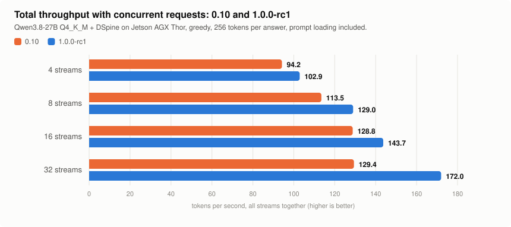

# Sixi-ASI Engine

Run Qwen3.8 on an NVIDIA Jetson AGX Thor. An inference engine with speculative decoding that leaves the answers
unchanged, parallel streams and an OpenAI-compatible API, as one download.

Measured with Qwen3.8-27B on an NVIDIA Jetson AGX Thor: **44 tok/s on one stream** (3.7x plain decoding at 12.1)
and **171 tok/s in total with 32 requests at once**. [How it was measured](docs/RESULTS.md).

<picture>
  <source media="(prefers-color-scheme: dark)" srcset="assets/streams-dark.svg">
  
</picture>

## Quick start

Download `sixi-asi-<version>-jetson-thor-aarch64.tar.gz` and its `.sha256` from the
[latest release](https://github.com/radeksixi/sixi-asi/releases/latest), then:

```bash
sha256sum -c sixi-asi-*-jetson-thor-aarch64.tar.gz.sha256
tar xzf sixi-asi-*-jetson-thor-aarch64.tar.gz && cd sixi-asi-*-jetson-thor-aarch64
./sixi setup      # checks that this machine can run the release (nothing is built)
./sixi pull       # downloads Qwen3.8-27B and its drafter: 18.9 GB, resumable, checksummed
./sixi chat       # talk to it in the terminal
```

**You need** an NVIDIA Jetson AGX Thor with JetPack (the file `BUILD` in the archive names the L4T and CUDA versions
the release was built with), 18.9 GB of disk for the default model, and Python 3.8+ for the `sixi` command.
Other NVIDIA machines are not covered by this release.

## Use it

**One question**

```bash
./sixi run "What is 17 * 23?"
./sixi run --json "Three European capitals with their countries."      # one JSON object, nothing around it
./sixi run --schema person.schema.json "Describe Ada Lovelace."        # JSON that matches your schema
```

**A server with the OpenAI API**

```bash
./sixi serve --parallel 4          # http://127.0.0.1:8089, four requests decoded at once
```

```bash
curl -s localhost:8089/v1/chat/completions -d '{
  "messages": [{"role": "user", "content": "What is 17*23?"}],
  "max_tokens": 1024, "temperature": 0 }'
```

```python
from openai import OpenAI

client = OpenAI(base_url="http://127.0.0.1:8089/v1", api_key="none")
r = client.chat.completions.create(
    model="qwen3.8-27b",
    messages=[{"role": "user", "content": "Classify: 'The battery died after two days.'"}],
    response_format={"type": "json_schema", "json_schema": {"name": "label", "strict": True, "schema": {
        "type": "object",
        "properties": {"sentiment": {"type": "string", "enum": ["positive", "neutral", "negative"]}},
        "required": ["sentiment"], "additionalProperties": False}}},
)
print(r.choices[0].message.content)     # one JSON object that matches the schema
```

**In the background, like a local model service**

```bash
./sixi service install --parallel 4     # once; add --boot to start it with your session
./sixi service start                    # the API stays at http://127.0.0.1:8089/v1 until ./sixi service stop
```

Any OpenAI client works with `base_url="http://127.0.0.1:8089/v1"`; `./sixi chat` and `./sixi run` use the
running service instead of loading the model again. More in [docs/SERVICE.md](docs/SERVICE.md).

Reasoning arrives separately as `reasoning_content`; send `"enable_thinking": false` to skip it. Every request
field, the extra metrics in the response and the error codes are in [docs/API.md](docs/API.md).

## Commands

| Command | What it does |
|---|---|
| `./sixi setup` | checks the machine: hardware, the engine, its libraries, CUDA |
| `./sixi doctor` | machine, engine, models, server: what is there and what is missing |
| `./sixi models` | models known by name, their size, whether they are downloaded |
| `./sixi pull [-m NAME]` | downloads a model from Hugging Face into `~/.sixi/models` (or finds it in the Hugging Face cache) |
| `./sixi chat [-m NAME]` | interactive chat; starts a server when none is running and stops it afterwards |
| `./sixi run "prompt"` | one answer on standard output (`--json`, `--schema FILE`, `--no-think`, `-q`) |
| `./sixi serve [-m NAME]` | the server in the foreground (`--parallel N`, `--ctx N`, `--port P`, `--api-key KEY`) |
| `./sixi stop` | stops a server that `chat --keep` or `run --keep` left running |
| `./sixi service install` | the server as a background service (systemd user unit): `start`, `stop`, `restart`, `status`, `logs`, `remove`; `--boot` starts it with your session |
| `./sixi link` | puts the command on the PATH as `sixi-asi` |

`-m` also takes a GGUF file (`./sixi serve -m model.gguf --draft drafter.gguf`). Options after `--` go to
`bin/sixi-server` as they are; `bin/sixi-server --help` lists them. Files live under `~/.sixi`
(`SIXI_HOME`, `SIXI_MODELS_DIR`).

## Models

| Name | Weights | Download | Notes |
|---|---|---|---|
| `qwen3.8-27b` (default) | Qwen3.8-27B, Unsloth Dynamic v3.1 UD-Q4_K_XL, with the DSpine block drafter | 18.9 GB | the measured configuration; parallel streams |
| `qwen3.8-flash-next` | Qwen3.8-Flash-Next (mixture of experts), UD-IQ4_XS, with its MTP draft head | 97.8 GB | one stream with drafts |

Both are Apache-2.0 and are downloaded from their authors' Hugging Face repositories (`configs/models.json` has the
repositories, sizes and checksums). No model is part of this archive.

## What the engine does

- **Speculative decoding that does not change the answer.** A small drafter proposes tokens and the model checks
  them, several per step. Greedy and sampled decoding both match plain decoding (tested on the distributions).
- **Parallel streams.** `--parallel N` (measured up to 32) answers N requests at once, and a long prompt being
  loaded does not stall the other conversations.
- **Structured answers.** `response_format` constrains the answer to one JSON object or to a JSON schema, also
  with drafts and parallel streams; a finished answer always parses and nothing follows its closing brace.
- **Samples and voting.** `n` samples of one prompt cost one prompt load; `"vote": true` returns the majority
  answer and stops the rest once it is decided.
- **Prompt cache.** A conversation continues from where it stopped, and a repeated prompt starts answering in
  1 ms; the cache can persist on disk.
- **Native Qwen3.8 chat template** (tools, reasoning effort, thinking on/off); reasoning budgets that end the
  reasoning instead of returning an empty answer; tool calls validated against their schema.

## Performance

NVIDIA Jetson AGX Thor, 1.0.0-rc1, measured on the files of this archive. Full tables, quality gates and the
comparison with other engines are in [docs/RESULTS.md](docs/RESULTS.md); what changed in each version is in
[CHANGELOG.md](CHANGELOG.md).

| | |
|---|---|
| Qwen3.8-27B, one stream, default weights (UD-Q4_K_XL v3.1) | 44.1 tok/s, 3.7x plain decoding |
| Qwen3.8-27B, 4 / 16 / 32 requests at once, in total | 98 / 152 / 171 tok/s |
| llama.cpp v1.0.0 on the same machine and weights, built-in MTP drafts | 29.3 tok/s |
| 16 agents with an 18k-token prompt each: wait for the next turn | under 3 s |
| JSON answers that parse, with a schema (120 cases) | 120 of 120 (103 without the constraint) |
| Qwen3.8-Flash-Next, one stream | 53 tok/s on code, 45 in conversation |
| Context memory for 32 streams | 27.1 GB |
| Default weights against BF16 | KL divergence 0.008 |

## Check the numbers yourself

The measurement scripts are in `scripts/` (Python 3, standard library):

```bash
python3 scripts/ab_bench.py --engines sixi=http://127.0.0.1:8089 --max-tokens 256 --repeats 3 --out ab.json
python3 scripts/concurrency_bench.py --url http://127.0.0.1:8089 --streams 1,2,4
python3 scripts/multistream_check.py --url http://127.0.0.1:8089 --streams 4
python3 scripts/schema_eval.py --url http://127.0.0.1:8089 --compare-free
python3 scripts/intel_eval.py --engines sixi=http://127.0.0.1:8089 --effort low --max-tokens 8192
```

`ab_bench.py` takes several engines (`--engines a=URL,b=URL --reference b`) and compares their answers with the
reference's, so any OpenAI-compatible server on the same machine can be put next to this one.

## License

The archive is free to use for any purpose and to pass on unchanged: see its `LICENSE` file (`LICENSE-BINARY` in
this repository). It includes llama.cpp, cpp-httplib and nlohmann/json under their MIT licenses (`licenses/`).
From 1.0.0-rc1 the engine is released in binary form; the sources in this repository are those of 0.11.0
(Apache-2.0, `LICENSE`).
