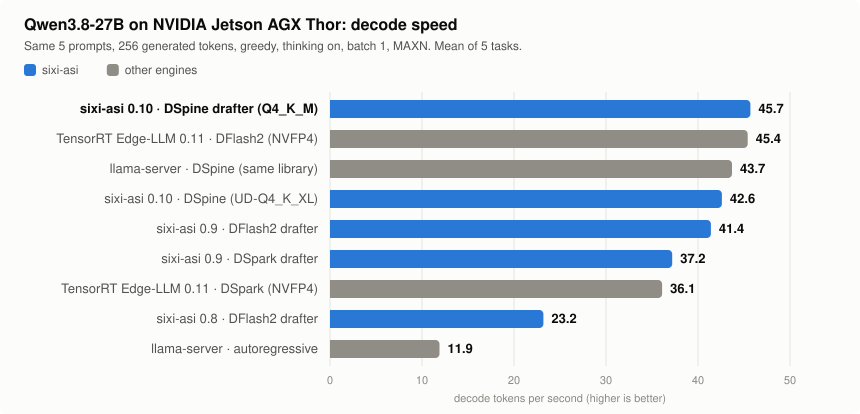

# Measured results

NVIDIA Jetson AGX Thor developer kit (122.9 GiB unified LPDDR5X, CUDA 13.2, MAXN). Qwen3.8-27B unless noted,
greedy, identical prompts for every engine, 256 generated tokens. The 1.0.0-rc1 rows were measured on 2026-11-14 on
the files of the released archive, with nothing else on the GPU; rows of other versions and engines carry their
own date or version.

<picture>
  <source media="(prefers-color-scheme: dark)" srcset="../assets/engines-dark.svg">
  
</picture>

**One stream** (`scripts/ab_bench.py`, median of 3 runs per task, mean of 5 tasks):

| Engine | Weights | Drafter | tok/s | vs plain decoding |
|---|---|---|---|---|
| **Sixi-ASI 1.0.0-rc1** | Q4_K_M | DSpine b16 | **46.0** | **3.8x** |
| TensorRT Edge-LLM 0.11.1 (2026-11-12) | NVFP4 | DFlash2 | 45.4 | 3.8x |
| **Sixi-ASI 1.0.0-rc1** | UD-Q4_K_XL v3.1 (default) | DSpine b16 | **44.1** | 3.7x |
| llama.cpp v1.0.0, llama-server | UD-Q4_K_XL v3.1 | built-in MTP, 4 drafts | 29.3 | 2.4x |
| llama.cpp v1.0.0, llama-server | UD-Q4_K_XL v3.1 | built-in MTP, 3 drafts, q4_0 KV cache | 27.3 | 2.3x |
| llama.cpp v1.0.0, llama-server, plain decoding | UD-Q4_K_XL v3.1 | - | 12.1 | 1.0x |

This test is five prompts. Two runs whose answers differ in a few tokens can differ by several percent on it,
because the drafter then agrees with the model for a different share of the text.

**Concurrent requests** (`scripts/concurrency_bench.py`: every client answers the same five prompts, rotated, so
the streams carry equal work; total = all completion tokens / wall time, prompt loading included). 1-4 streams on
`--parallel 4`, 8-32 on `--parallel 32`:

| Concurrent streams | 1 | 2 | 4 | 8 | 16 | 32 |
|---|---|---|---|---|---|---|
| 1.0.0-rc1, UD-Q4_K_XL v3.1 (default) | 38.2 | 63.9 | 97.7 | 117.1 | 151.7 | **171.0** |
| 1.0.0-rc1, Q4_K_M | 40.5 | 65.7 | 102.9 | 129.0 | 143.7 | **172.0** |
| 0.11, UD-Q4_K_XL v3.1 | 37.7 | 63.7 | 90.3 | 118.7 | 150.6 | 170.5 |
| 0.10, Q4_K_M | 39.6 | 62.1 | 94.2 | 113.5 | 128.8 | 129.4 |

The default-weights figures for 8, 16 and 32 streams are means of three runs (112.9-122.8, 145.9-155.1,
169.3-172.6); the others are single runs, and a single run at 8-16 streams spreads by several percent.

With 32 streams each one decodes at 5.4-5.9 tok/s; with 16, about 10. Context memory for 32 streams: 27.1 GB
(25.3 GiB) for the model and 6.0 GB (5.6 GiB) for the drafter.

**Many agents with long prompts** (`scripts/agents_bench.py`: 16 agents, each with its own 18k-token document and
two follow-up questions, `--parallel 16 --ctx 24576`, default weights): a follow-up reaches its first token after
2.8 s (median), 2.9 s at worst, while other agents are still loading their documents; the first answer takes 272 s
(median) because sixteen 18k-token loads share one device. All three turns of all agents: 553 s.

**Quality gate** (`scripts/intel_eval.py`, reasoning effort low, thinking on, greedy, up to 8192 tokens):

| Run | GSM8K | HumanEval | Tool calls | Needle (6k) |
|---|---|---|---|---|
| Sixi-ASI 1.0.0-rc1, DSpine, UD-Q4_K_XL v3.1 | 28/30 | 19/20 | pass | pass |
| same, as three concurrent clients on `--parallel 4` | 28/30 each | 18, 19, 19 of 20 | pass | pass |
| Sixi-ASI 0.11, DSpine, UD-Q4_K_XL v3.1 | 28/30 | 19/20 | pass | pass |
| Sixi-ASI 0.10, DSpine, Q4_K_M, wider sample | 76/80 | 58/60 | | |
| TensorRT Edge-LLM, DFlash2, NVFP4 (0.9.0 run) | 28/30 | 19/20 | pass | pass |

Concurrent answers are not byte-identical to a solo run of the same prompt: they diverge after a few hundred
characters, and the scores above are the same either way. Repeated solo runs are identical
(`scripts/multistream_check.py`).

**Structured answers** (`scripts/schema_eval.py`: the same prompt, which contains the schema, with and without
`response_format`):

| Set | With the constraint | Without |
|---|---|---|
| 10 agent-style schemas x 3 prompts in five languages, one stream | 30/30 valid | 23/30 |
| 30 general schemas x 3 prompts, one stream | 90/90 | 80/90 |
| agent schemas, 8 streams | 30/30 | |
| general schemas, 8 streams | 89/90; one answer reached `max_tokens` inside the document (`finish_reason: length`) | |
| general schemas, sampled (temperature above 0) | 90/90 | |
| general schemas with reasoning on | 30/30 | |

The constraint costs about 2% of the speed on answers the model would have written correctly anyway (2-5% over a whole set).

**Qwen3.8-Flash-Next** (UD-IQ4_XS with its MTP head, one stream, benchmark program with a fixed draft length,
median of three repeats):

| | Plain decoding | With drafts |
|---|---|---|
| Code prompt | 26.2 | 52.8 |
| Conversation prompt | 28.3 | 44.6 |

**Hard reasoning** (0.11 run: 40 AIME problems, 3 samples each, temperature 0.6, reasoning effort low, 10240 tokens,
4 streams):

| Weights | One sample | Majority of 3 | Any of 3 | KL divergence to BF16 |
|---|---|---|---|---|
| UD-Q4_K_XL v3.1 (default) | 70.0% | 82.5% | 82.5% | 0.0077 |
| Q4_K_M | 70.0% | 80.0% | 85.0% | 0.0248 |

**Long context** (0.10 run, `--ctx 65536`, DSpine, Q4_K_M):

| Document | First question | Prompt loading | Next question | Decode |
|---|---|---|---|---|
| 4.8k tokens | 6.9 s | 698 tok/s | 0.31 s | 30-45 tok/s |
| 15k | 21 s | 711 tok/s | 0.39 s | 29-48 tok/s |
| 34k | 52 s | 653 tok/s | 0.48 s | 24-36 tok/s |
| 59k | 104 s | 571 tok/s | 0.58 s | 22-26 tok/s |

64k tokens of context take about 4.5 GB per stream.
